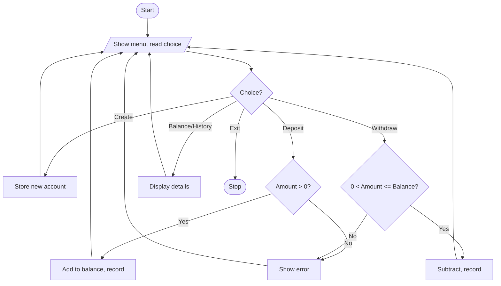
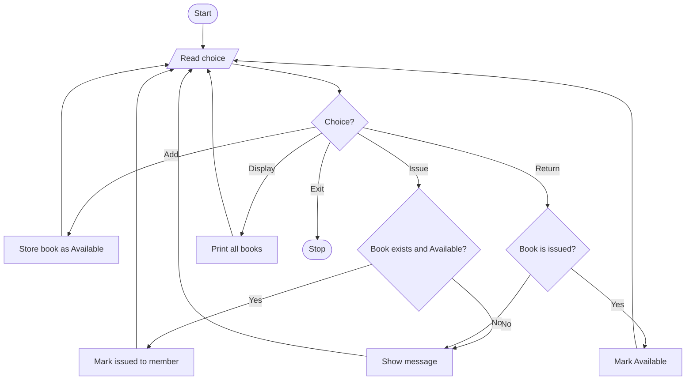
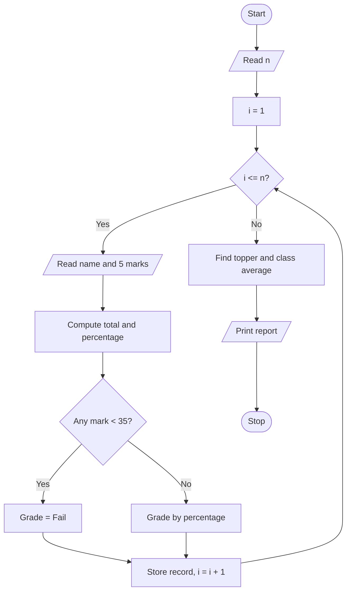
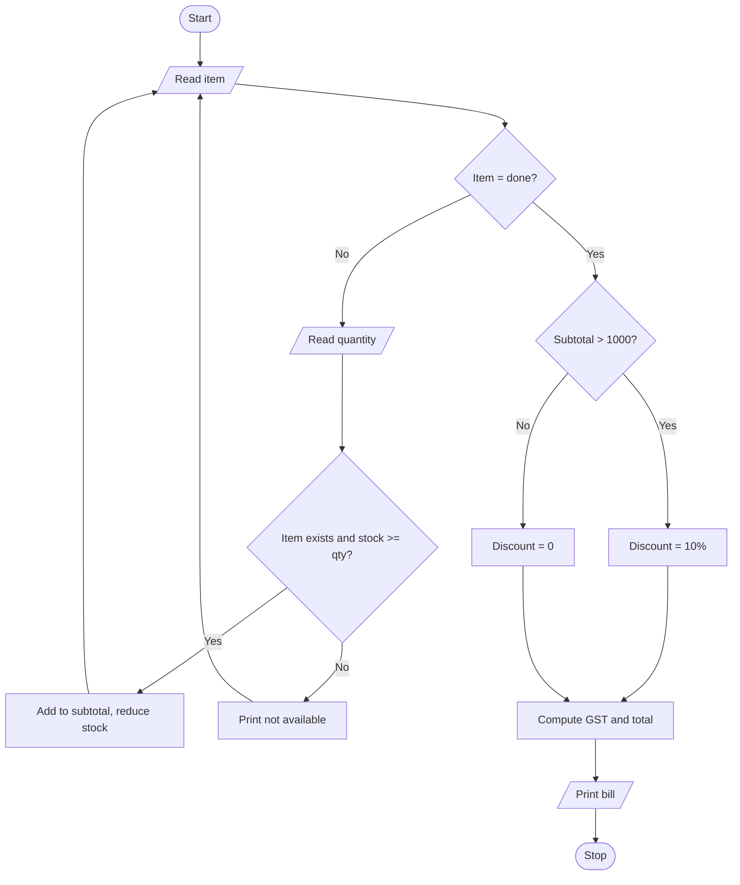
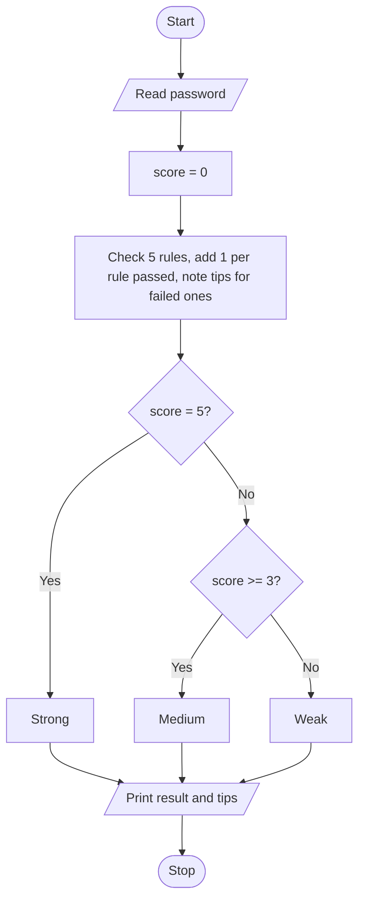
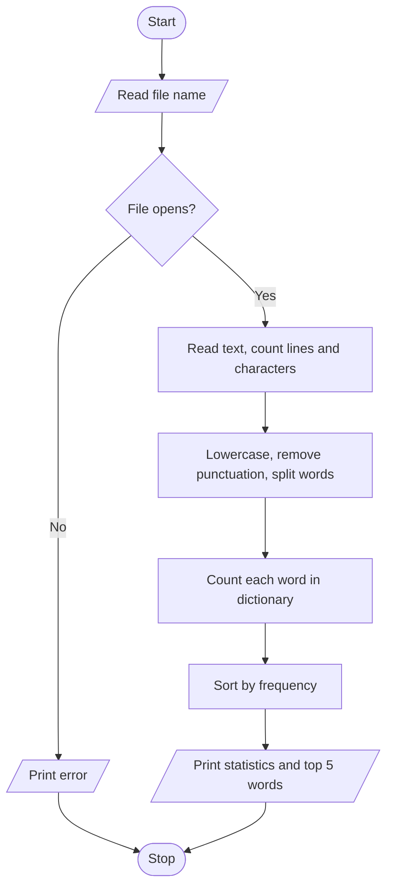
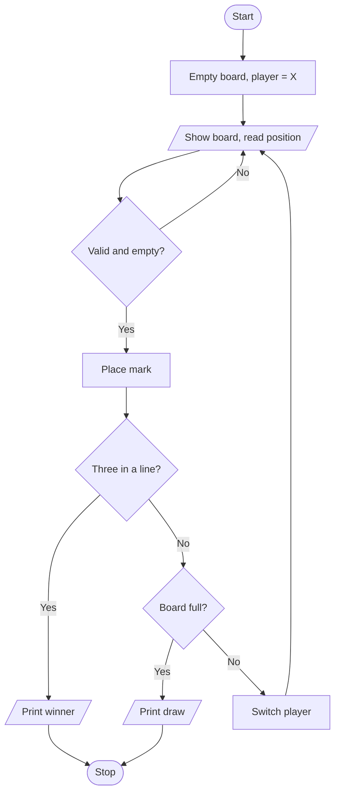
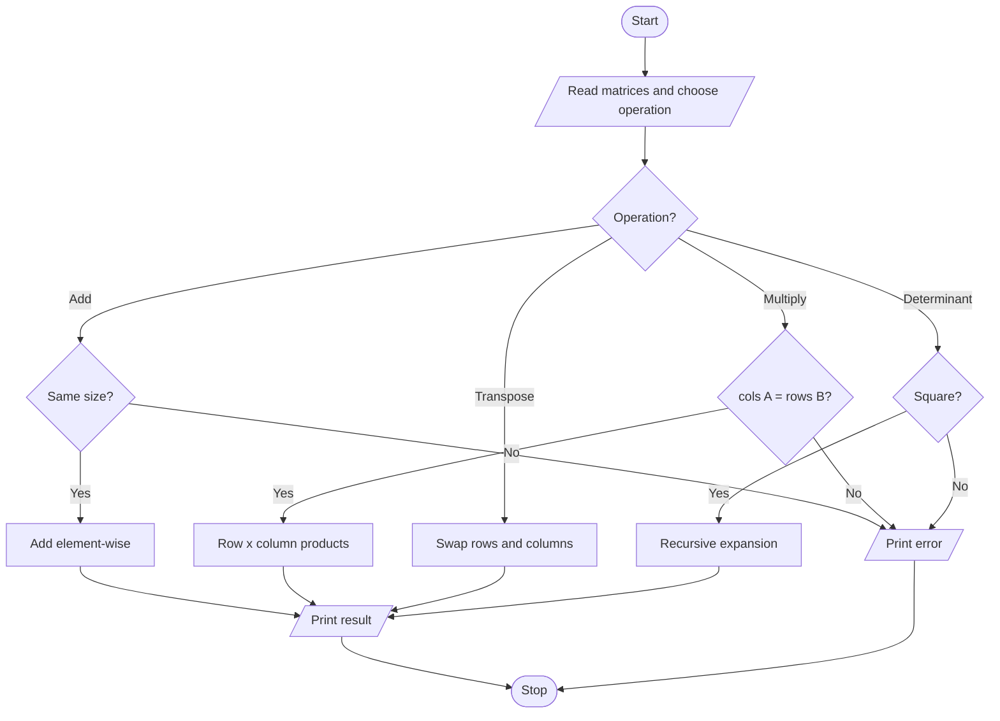
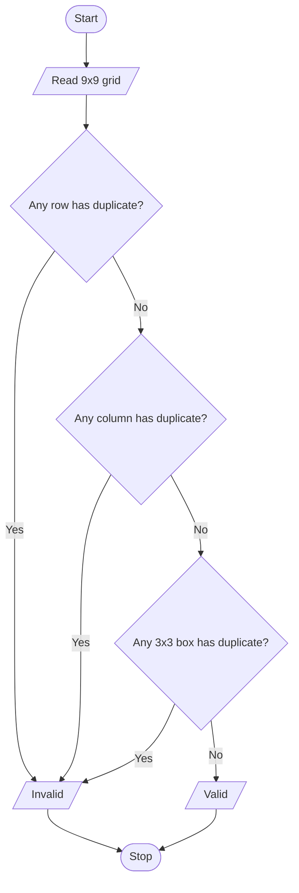
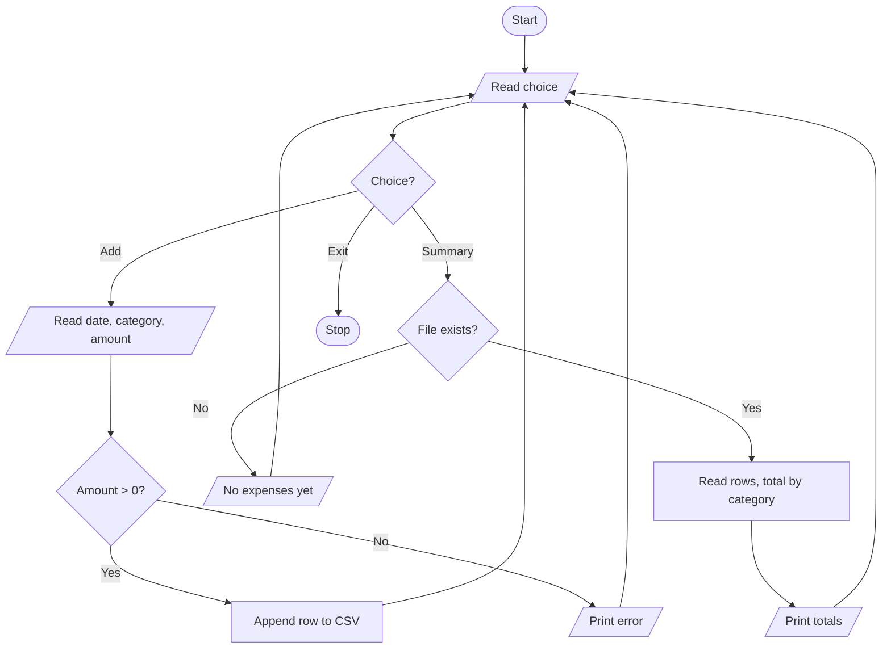

# Python Activity-Based Learning – 10 Case Studies

Each case study has: Problem Statement, Objectives, Assumptions, Algorithm, Pseudocode, Flowchart (Mermaid – GitHub draws it automatically), Source Code, Test Cases, Conclusion.

Selected case studies:
1. Banking System
2. Library Management System
3. Student Result Analyzer
4. Inventory and Billing System
5. Password Strength Checker
6. Text File Analyzer (Word Frequency)
7. Tic-Tac-Toe Game
8. Matrix Operations Calculator
9. Sudoku Validator
10. Expense Tracker (CSV File Handling)

---

## 1. Banking System

### Problem Statement
Develop a console-based banking program where a customer can create an account, deposit money, withdraw money, check the balance and view the transaction history.

### Objectives
- Apply classes and objects, lists and dictionaries.
- Validate input and handle invalid transactions.
- Keep a record of every transaction.

### Assumptions
- Amounts are positive numbers (rupees).
- Account numbers are unique.
- Data is kept in memory only (lost when the program ends).

### Algorithm
1. Start and show the menu.
2. Create account: read number, name, opening balance; store it.
3. Deposit: if amount > 0, add to balance and record it.
4. Withdraw: if amount > 0 and amount <= balance, subtract and record it; otherwise show an error.
5. Show balance / history for the chosen account.
6. Repeat until the user selects Exit.

### Pseudocode
```
START
accounts = {}
REPEAT
    DISPLAY menu, READ choice
    IF choice = Create: READ no, name, balance; accounts[no] = new account
    ELSE IF choice = Deposit: READ no, amt; IF amt > 0 THEN balance += amt ELSE error
    ELSE IF choice = Withdraw: READ no, amt; IF 0 < amt <= balance THEN balance -= amt ELSE error
    ELSE IF choice = Balance/History: DISPLAY details
UNTIL choice = Exit
STOP
```

### Flowchart


### Source Code
```python
# banking_system.py
# A simple banking system using a class.

class BankAccount:
    def __init__(self, acc_no, name, balance=0):
        self.acc_no = acc_no          # unique account number
        self.name = name              # account holder name
        self.balance = balance        # current balance
        self.history = []             # list of (type, amount) tuples

    def deposit(self, amount):
        if amount <= 0:               # reject zero / negative amounts
            return "Invalid amount"
        self.balance += amount
        self.history.append(("Deposit", amount))
        return "Deposited successfully"

    def withdraw(self, amount):
        if amount <= 0:
            return "Invalid amount"
        if amount > self.balance:     # cannot withdraw more than balance
            return "Insufficient funds"
        self.balance -= amount
        self.history.append(("Withdraw", amount))
        return "Withdrawn successfully"


def main():
    accounts = {}                     # account number -> BankAccount
    while True:
        print("\n1.Create  2.Deposit  3.Withdraw  4.Balance  5.History  6.Exit")
        choice = input("Enter choice: ")
        if choice == "6":
            print("Thank you!")
            break
        acc_no = input("Account number: ")
        if choice == "1":
            if acc_no in accounts:
                print("Account already exists")
            else:
                name = input("Name: ")
                opening = float(input("Opening balance: "))
                accounts[acc_no] = BankAccount(acc_no, name, opening)
                print("Account created")
        elif acc_no not in accounts:
            print("Account not found")
        elif choice == "2":
            print(accounts[acc_no].deposit(float(input("Amount: "))))
        elif choice == "3":
            print(accounts[acc_no].withdraw(float(input("Amount: "))))
        elif choice == "4":
            print("Balance:", accounts[acc_no].balance)
        elif choice == "5":
            for kind, amt in accounts[acc_no].history:
                print(kind, amt)
        else:
            print("Invalid choice")


if __name__ == "__main__":
    main()
```

### Test Cases
| # | Input | Expected Output |
|---|-------|-----------------|
| 1 | Create A1, "Ravi", 1000 | Account created |
| 2 | Deposit 500 into A1 | Deposited successfully; balance 1500 |
| 3 | Withdraw 2000 from A1 (balance 1500) | Insufficient funds |
| 4 | Withdraw 300 from A1 | Withdrawn successfully; balance 1200 |
| 5 | Deposit -100 | Invalid amount |
| 6 | Deposit into unknown account A9 | Account not found |

### Conclusion
The program shows how a class groups data and behaviour together. Input validation prevents wrong transactions, and the history list keeps an audit trail.

---

## 2. Library Management System

### Problem Statement
Build a program that manages a library's books: add books, display all books, issue a book to a member and accept returns.

### Objectives
- Use dictionaries and functions for data management.
- Track availability of each book.
- Prevent issuing an already-issued book.

### Assumptions
- Each book has a unique ID and only one copy.
- Member names are plain text.
- Data is stored in memory only.

### Algorithm
1. Show menu.
2. Add: store book ID, title, status "Available".
3. Issue: if ID exists and status is Available, set status to the member's name; else show message.
4. Return: if book is issued, set status back to Available.
5. Display: print all books with status.
6. Repeat until Exit.

### Pseudocode
```
START
books = {}
REPEAT
    READ choice
    IF Add: books[id] = [title, "Available"]
    IF Issue:
        IF id not in books THEN "Not found"
        ELSE IF status != "Available" THEN "Already issued"
        ELSE status = member
    IF Return:
        IF id in books AND status != "Available" THEN status = "Available"
        ELSE "Invalid return"
    IF Display: PRINT all books
UNTIL Exit
STOP
```

### Flowchart


### Source Code
```python
# library_management.py

books = {}   # book_id -> [title, status]


def add_book(book_id, title):
    if book_id in books:
        return "Book ID already exists"
    books[book_id] = [title, "Available"]
    return "Book added"


def issue_book(book_id, member):
    if book_id not in books:
        return "Book not found"
    if books[book_id][1] != "Available":     # already given to someone
        return "Book already issued"
    books[book_id][1] = member
    return "Book issued to " + member


def return_book(book_id):
    if book_id not in books or books[book_id][1] == "Available":
        return "Invalid return"
    books[book_id][1] = "Available"
    return "Book returned"


def display_books():
    for book_id, (title, status) in books.items():
        print(book_id, "|", title, "|", status)


def main():
    while True:
        print("\n1.Add 2.Issue 3.Return 4.Display 5.Exit")
        ch = input("Choice: ")
        if ch == "1":
            print(add_book(input("ID: "), input("Title: ")))
        elif ch == "2":
            print(issue_book(input("ID: "), input("Member: ")))
        elif ch == "3":
            print(return_book(input("ID: ")))
        elif ch == "4":
            display_books()
        elif ch == "5":
            break
        else:
            print("Invalid choice")


if __name__ == "__main__":
    main()
```

### Test Cases
| # | Input | Expected Output |
|---|-------|-----------------|
| 1 | Add B1 "Python Basics" | Book added |
| 2 | Add B1 again | Book ID already exists |
| 3 | Issue B1 to "Anil" | Book issued to Anil |
| 4 | Issue B1 to "Sita" | Book already issued |
| 5 | Return B1 | Book returned |
| 6 | Return B1 again | Invalid return |
| 7 | Issue B9 | Book not found |

### Conclusion
Dictionaries make lookups by book ID fast and simple. Checking the status before every action avoids duplicate issues and invalid returns.

---

## 3. Student Result Analyzer

### Problem Statement
Read marks of several students in five subjects and compute each student's total, percentage, grade and pass/fail result, then find the class topper and class average.

### Objectives
- Use lists, dictionaries, loops and functions.
- Apply conditional logic for grading.
- Find maximum and average values.

### Assumptions
- Marks are integers from 0 to 100.
- Five subjects per student.
- A student fails if any subject is below 35.

### Algorithm
1. Read number of students.
2. For each student read name and five marks.
3. Total = sum of marks; percentage = total / 5.
4. If any mark < 35, result is Fail, else grade by percentage (>=90 A+, >=80 A, >=70 B, >=60 C, >=50 D, else E).
5. Find the student with the highest percentage (topper) and the class average.
6. Print the report.

### Pseudocode
```
START
READ n
FOR i = 1 TO n
    READ name, marks[5]
    total = SUM(marks); pct = total / 5
    IF MIN(marks) < 35 THEN grade = "Fail" ELSE grade = grade_for(pct)
    STORE name, total, pct, grade
END FOR
topper = student with MAX pct
class_avg = AVERAGE of all pct
PRINT report, topper, class_avg
STOP
```

### Flowchart


### Source Code
```python
# student_result_analyzer.py

def get_grade(percentage):
    """Return grade letter for a percentage."""
    if percentage >= 90:
        return "A+"
    elif percentage >= 80:
        return "A"
    elif percentage >= 70:
        return "B"
    elif percentage >= 60:
        return "C"
    elif percentage >= 50:
        return "D"
    return "E"


def analyze(marks):
    """Return total, percentage, grade for a list of 5 marks."""
    total = sum(marks)
    percentage = total / len(marks)
    if min(marks) < 35:               # failing in any subject
        grade = "Fail"
    else:
        grade = get_grade(percentage)
    return total, percentage, grade


def main():
    students = []
    n = int(input("Number of students: "))
    for _ in range(n):
        name = input("Name: ")
        marks = [int(input(f"  Subject {i+1} marks: ")) for i in range(5)]
        total, pct, grade = analyze(marks)
        students.append((name, total, pct, grade))

    print("\nName      Total   %      Grade")
    for name, total, pct, grade in students:
        print(f"{name:<9} {total:<7} {pct:<6.2f} {grade}")

    topper = max(students, key=lambda s: s[2])      # highest percentage
    average = sum(s[2] for s in students) / len(students)
    print("\nTopper:", topper[0], "with", round(topper[2], 2), "%")
    print("Class average:", round(average, 2), "%")


if __name__ == "__main__":
    main()
```

### Test Cases
| # | Marks | Expected Output |
|---|-------|-----------------|
| 1 | 90, 95, 92, 91, 97 | Total 465, 93.00 %, A+ |
| 2 | 80, 70, 75, 85, 90 | Total 400, 80.00 %, A |
| 3 | 60, 65, 62, 58, 55 | Total 300, 60.00 %, C |
| 4 | 90, 90, 30, 90, 90 | Fail (one subject < 35) |
| 5 | 50, 50, 50, 50, 50 | Total 250, 50.00 %, D |

### Conclusion
The program automates result processing. Separating grading and analysis into functions keeps the code readable and easy to test.

---

## 4. Inventory and Billing System

### Problem Statement
Create a shop program that stores items with price and stock, lets the user add items to a cart and prints a bill with discount and GST.

### Objectives
- Use nested dictionaries and loops.
- Update stock after each sale.
- Calculate discount and tax correctly.

### Assumptions
- 10% discount if subtotal exceeds ₹1000.
- GST is 5% on the amount after discount.
- Item names are unique and entered in lowercase.

### Algorithm
1. Load inventory (name -> price, stock).
2. Repeatedly read item name and quantity until the user types "done".
3. If item exists and stock >= quantity, add price × quantity to subtotal and reduce stock; else show a message.
4. If subtotal > 1000, discount = 10% of subtotal.
5. GST = 5% of (subtotal − discount); total = subtotal − discount + GST.
6. Print the bill.

### Pseudocode
```
START
inventory = {name: {price, stock}}
subtotal = 0
REPEAT
    READ item
    IF item = "done" THEN BREAK
    READ qty
    IF item in inventory AND stock >= qty THEN
        subtotal += price * qty; stock -= qty
    ELSE PRINT "Not available"
UNTIL done
IF subtotal > 1000 THEN discount = 0.10 * subtotal ELSE discount = 0
gst = 0.05 * (subtotal - discount)
total = subtotal - discount + gst
PRINT bill
STOP
```

### Flowchart


### Source Code
```python
# inventory_billing.py

inventory = {
    "pen":      {"price": 10,   "stock": 100},
    "notebook": {"price": 50,   "stock": 40},
    "bag":      {"price": 800,  "stock": 10},
    "calculator": {"price": 450, "stock": 5},
}


def add_to_bill(item, qty):
    """Return cost of the item or None if not available. Reduces stock."""
    if item not in inventory or inventory[item]["stock"] < qty or qty <= 0:
        return None
    inventory[item]["stock"] -= qty
    return inventory[item]["price"] * qty


def calculate_total(subtotal):
    """Return (discount, gst, total) for a given subtotal."""
    discount = 0.10 * subtotal if subtotal > 1000 else 0
    gst = 0.05 * (subtotal - discount)
    total = subtotal - discount + gst
    return discount, gst, total


def main():
    subtotal = 0
    while True:
        item = input("Item (or 'done'): ").lower()
        if item == "done":
            break
        qty = int(input("Quantity: "))
        cost = add_to_bill(item, qty)
        if cost is None:
            print("Item not available / insufficient stock")
        else:
            subtotal += cost
            print("Added. Running subtotal:", subtotal)

    discount, gst, total = calculate_total(subtotal)
    print("\n----- BILL -----")
    print("Subtotal :", subtotal)
    print("Discount :", discount)
    print("GST (5%) :", round(gst, 2))
    print("TOTAL    :", round(total, 2))


if __name__ == "__main__":
    main()
```

### Test Cases
| # | Cart | Expected Output |
|---|------|-----------------|
| 1 | pen × 5 | Subtotal 50, discount 0, GST 2.5, total 52.5 |
| 2 | bag × 2 | Subtotal 1600, discount 160, GST 72, total 1512 |
| 3 | bag × 11 | Item not available / insufficient stock |
| 4 | laptop × 1 | Item not available / insufficient stock |
| 5 | notebook × 20 | Subtotal 1000, discount 0 (not above 1000), GST 50, total 1050 |

### Conclusion
Nested dictionaries model real inventory neatly. Keeping the tax logic in its own function makes bill calculation easy to verify.

---

## 5. Password Strength Checker

### Problem Statement
Write a program that checks the strength of a password and reports Weak, Medium or Strong along with suggestions to improve it.

### Objectives
- Work with strings and string methods.
- Apply multiple conditions.
- Give useful feedback to the user.

### Assumptions
- Special characters are those in `!@#$%^&*()-_+=`.
- Score of 5 = Strong, 3–4 = Medium, below 3 = Weak.

### Algorithm
1. Read the password.
2. Score = 0. Add 1 for each rule satisfied: length >= 8, has uppercase, has lowercase, has digit, has special character.
3. Build a list of suggestions for rules that failed.
4. Classify using the score and print result and suggestions.

### Pseudocode
```
START
READ pwd
score = 0; tips = []
IF LENGTH(pwd) >= 8 THEN score++ ELSE tips.add("Use 8+ characters")
IF has uppercase THEN score++ ELSE tips.add("Add uppercase")
IF has lowercase THEN score++ ELSE tips.add("Add lowercase")
IF has digit THEN score++ ELSE tips.add("Add a digit")
IF has special THEN score++ ELSE tips.add("Add a special character")
IF score = 5 THEN "Strong" ELSE IF score >= 3 THEN "Medium" ELSE "Weak"
PRINT result, tips
STOP
```

### Flowchart


### Source Code
```python
# password_checker.py

SPECIAL = "!@#$%^&*()-_+="


def check_password(pwd):
    """Return (strength, list_of_tips) for the given password."""
    score = 0
    tips = []

    if len(pwd) >= 8:
        score += 1
    else:
        tips.append("Use at least 8 characters")

    if any(ch.isupper() for ch in pwd):
        score += 1
    else:
        tips.append("Add an uppercase letter")

    if any(ch.islower() for ch in pwd):
        score += 1
    else:
        tips.append("Add a lowercase letter")

    if any(ch.isdigit() for ch in pwd):
        score += 1
    else:
        tips.append("Add a digit")

    if any(ch in SPECIAL for ch in pwd):
        score += 1
    else:
        tips.append("Add a special character")

    if score == 5:
        strength = "Strong"
    elif score >= 3:
        strength = "Medium"
    else:
        strength = "Weak"
    return strength, tips


def main():
    pwd = input("Enter password: ")
    strength, tips = check_password(pwd)
    print("Strength:", strength)
    for tip in tips:
        print("-", tip)


if __name__ == "__main__":
    main()
```

### Test Cases
| # | Password | Expected Output |
|---|----------|-----------------|
| 1 | `abc` | Weak (score 1) |
| 2 | `abcdefgh` | Weak (score 2) |
| 3 | `Abcdefgh1` | Medium (score 4) |
| 4 | `Abcd@1234` | Strong (score 5) |
| 5 | `12345678` | Weak (score 2) |
| 6 | `` (empty) | Weak (score 0) |

### Conclusion
String methods and `any()` make rule checking short and clear. Showing suggestions helps users build stronger passwords.

---

## 6. Text File Analyzer (Word Frequency)

### Problem Statement
Read a text file (or typed text) and report the number of lines, words, characters and the most frequent words.

### Objectives
- Practise file handling with `open()` and exceptions.
- Use dictionaries to count frequency.
- Clean text by removing punctuation and ignoring case.

### Assumptions
- File is plain text in UTF-8.
- Words are separated by whitespace.
- "The" and "the" count as the same word.

### Algorithm
1. Read file name and try to open it; if missing, show an error.
2. Count lines and characters.
3. Convert text to lowercase, remove punctuation, split into words.
4. Count each word in a dictionary.
5. Sort by frequency and print the top 5.

### Pseudocode
```
START
READ filename
TRY open file and READ text
EXCEPT file not found -> PRINT error, STOP
lines = number of lines; chars = LENGTH(text)
words = SPLIT(LOWER(text without punctuation))
FOR each word: freq[word] += 1
SORT freq by count descending
PRINT lines, words count, chars, top 5
STOP
```

### Flowchart


### Source Code
```python
# text_analyzer.py
import string


def analyze_text(text):
    """Return (lines, word_count, char_count, top_words) for the text."""
    lines = len(text.splitlines())
    chars = len(text)

    # remove punctuation and make lowercase
    cleaned = text.lower().translate(str.maketrans("", "", string.punctuation))
    words = cleaned.split()

    freq = {}
    for w in words:
        freq[w] = freq.get(w, 0) + 1          # count occurrences

    # sort by count (high to low), then alphabetically
    top = sorted(freq.items(), key=lambda x: (-x[1], x[0]))[:5]
    return lines, len(words), chars, top


def main():
    filename = input("Enter file name: ")
    try:
        with open(filename, "r", encoding="utf-8") as f:
            text = f.read()
    except FileNotFoundError:
        print("File not found")
        return

    lines, words, chars, top = analyze_text(text)
    print("Lines:", lines)
    print("Words:", words)
    print("Characters:", chars)
    print("Top words:")
    for word, count in top:
        print(f"  {word}: {count}")


if __name__ == "__main__":
    main()
```

### Test Cases
| # | File Content | Expected Output |
|---|--------------|-----------------|
| 1 | `Hello world` | Lines 1, Words 2, Chars 11 |
| 2 | `The cat. The dog!` | Words 4, top: the: 2, cat: 1, dog: 1 |
| 3 | `a a a b b c` | top: a: 3, b: 2, c: 1 |
| 4 | Empty file | Lines 0, Words 0, Chars 0 |
| 5 | `missing.txt` (does not exist) | File not found |

### Conclusion
The program combines file handling, exception handling and dictionaries, which are the core tools for text processing in Python.

---

## 7. Tic-Tac-Toe Game

### Problem Statement
Implement a two-player Tic-Tac-Toe game on a 3×3 board in the console, detecting a win or a draw.

### Objectives
- Use 2D lists and loops.
- Validate player moves.
- Detect winning combinations.

### Assumptions
- Players X and O alternate, X starts.
- Cells are numbered 1–9.
- A cell cannot be reused.

### Algorithm
1. Create an empty board of 9 cells.
2. Show the board; the current player enters a cell number (1–9).
3. If the cell is invalid or taken, ask again.
4. Place the mark. If any row, column or diagonal has three equal marks, that player wins.
5. If all 9 cells are filled with no winner, it is a draw.
6. Otherwise switch player and repeat.

### Pseudocode
```
START
board = [" "] * 9; player = "X"
REPEAT
    PRINT board
    READ pos
    IF pos invalid OR board[pos-1] != " " THEN CONTINUE
    board[pos-1] = player
    IF winner(board) THEN PRINT player wins; BREAK
    IF no empty cell THEN PRINT draw; BREAK
    switch player
UNTIL game over
STOP
```

### Flowchart


### Source Code
```python
# tic_tac_toe.py

# all 8 winning lines (index positions on a board of 9 cells)
WIN_LINES = [(0, 1, 2), (3, 4, 5), (6, 7, 8),      # rows
             (0, 3, 6), (1, 4, 7), (2, 5, 8),      # columns
             (0, 4, 8), (2, 4, 6)]                 # diagonals


def check_winner(board):
    """Return 'X' or 'O' if someone has won, 'Draw' if full, else None."""
    for a, b, c in WIN_LINES:
        if board[a] != " " and board[a] == board[b] == board[c]:
            return board[a]
    if " " not in board:
        return "Draw"
    return None


def show_board(board):
    print()
    for i in range(0, 9, 3):
        print(" " + " | ".join(board[i:i + 3]))
        if i < 6:
            print("---+---+---")


def main():
    board = [" "] * 9
    player = "X"
    while True:
        show_board(board)
        try:
            pos = int(input(f"Player {player}, choose cell (1-9): "))
        except ValueError:
            print("Enter a number")
            continue
        if pos < 1 or pos > 9 or board[pos - 1] != " ":
            print("Invalid or occupied cell")
            continue
        board[pos - 1] = player
        result = check_winner(board)
        if result == "Draw":
            show_board(board)
            print("It's a draw!")
            break
        elif result:
            show_board(board)
            print("Player", result, "wins!")
            break
        player = "O" if player == "X" else "X"


if __name__ == "__main__":
    main()
```

### Test Cases
| # | Board (cells 1–9) | Expected Result |
|---|-------------------|-----------------|
| 1 | X X X / O O _ / _ _ _ | X wins (top row) |
| 2 | O _ _ / O X _ / O _ X | O wins (first column) |
| 3 | X O _ / O X _ / _ _ X | X wins (diagonal) |
| 4 | X O X / X O O / O X X | Draw |
| 5 | Player picks cell 10 | Invalid or occupied cell |
| 6 | Player picks occupied cell | Invalid or occupied cell |

### Conclusion
Storing the winning lines as data keeps the win check short and less error-prone than many nested `if` statements.

---

## 8. Matrix Operations Calculator

### Problem Statement
Perform addition, multiplication, transpose and determinant of matrices using nested lists, without external libraries.

### Objectives
- Use nested loops and 2D lists.
- Check dimension rules before operating.
- Apply recursion for the determinant.

### Assumptions
- Matrices contain numbers.
- Determinant is for square matrices only.
- Matrices are entered row by row.

### Algorithm
1. Read matrix A (and B for binary operations).
2. Addition: if sizes are equal, add element by element.
3. Multiplication: if columns of A = rows of B, compute C[i][j] = sum of A[i][k] × B[k][j].
4. Transpose: swap rows and columns.
5. Determinant: for 1×1 return the element; otherwise expand along the first row recursively with alternating signs.

### Pseudocode
```
FUNCTION add(A, B): IF size differs RETURN None; RETURN element-wise sum
FUNCTION multiply(A, B):
    IF cols(A) != rows(B) RETURN None
    FOR i, j: C[i][j] = SUM over k of A[i][k] * B[k][j]
FUNCTION transpose(A): T[j][i] = A[i][j]
FUNCTION det(A):
    IF size = 1 RETURN A[0][0]
    total = 0
    FOR c = 0 TO n-1: total += (-1)^c * A[0][c] * det(minor(A, 0, c))
    RETURN total
```

### Flowchart


### Source Code
```python
# matrix_operations.py

def add(a, b):
    if len(a) != len(b) or len(a[0]) != len(b[0]):
        return None                               # sizes must match
    return [[a[i][j] + b[i][j] for j in range(len(a[0]))]
            for i in range(len(a))]


def multiply(a, b):
    if len(a[0]) != len(b):                       # cols of A must equal rows of B
        return None
    result = [[0] * len(b[0]) for _ in range(len(a))]
    for i in range(len(a)):
        for j in range(len(b[0])):
            for k in range(len(b)):
                result[i][j] += a[i][k] * b[k][j]
    return result


def transpose(a):
    return [[a[i][j] for i in range(len(a))] for j in range(len(a[0]))]


def determinant(a):
    if len(a) != len(a[0]):
        return None                               # only square matrices
    if len(a) == 1:
        return a[0][0]
    total = 0
    for c in range(len(a)):
        # minor: remove first row and column c
        minor = [row[:c] + row[c + 1:] for row in a[1:]]
        total += ((-1) ** c) * a[0][c] * determinant(minor)
    return total


def read_matrix(name):
    rows = int(input(f"Rows of {name}: "))
    print("Enter each row with spaces between numbers")
    return [list(map(float, input().split())) for _ in range(rows)]


def main():
    print("1.Add 2.Multiply 3.Transpose 4.Determinant")
    ch = input("Choice: ")
    a = read_matrix("A")
    if ch in ("1", "2"):
        b = read_matrix("B")
        result = add(a, b) if ch == "1" else multiply(a, b)
    elif ch == "3":
        result = transpose(a)
    else:
        result = determinant(a)
    print("Result:", result if result is not None else "Operation not possible")


if __name__ == "__main__":
    main()
```

### Test Cases
| # | Operation | Input | Expected Output |
|---|-----------|-------|-----------------|
| 1 | Add | [[1,2],[3,4]] + [[5,6],[7,8]] | [[6,8],[10,12]] |
| 2 | Multiply | [[1,2],[3,4]] × [[5,6],[7,8]] | [[19,22],[43,50]] |
| 3 | Transpose | [[1,2,3],[4,5,6]] | [[1,4],[2,5],[3,6]] |
| 4 | Determinant | [[1,2],[3,4]] | -2 |
| 5 | Determinant | [[2,0,1],[1,3,2],[1,1,1]] | 0 |
| 6 | Add | 2×2 + 3×3 | Operation not possible |

### Conclusion
Nested loops and recursion implement matrix algebra from first principles, and size checks avoid invalid operations.

---

## 9. Sudoku Validator

### Problem Statement
Given a completed or partially filled 9×9 Sudoku grid, check whether it is valid: no repeated digit 1–9 in any row, column or 3×3 box.

### Objectives
- Use 2D lists, sets and nested loops.
- Break a larger problem into smaller functions.
- Understand sub-grid indexing.

### Assumptions
- Empty cells are represented by 0.
- Grid is always 9×9 with integers 0–9.
- A grid with no conflicts is "valid", even if incomplete.

### Algorithm
1. For each row, collect non-zero numbers; if a duplicate exists, invalid.
2. Repeat for each column.
3. For each of the nine 3×3 boxes (starting at rows/columns 0, 3, 6), check for duplicates.
4. If no duplicates are found, the grid is valid.

### Pseudocode
```
FUNCTION has_duplicates(cells):
    nums = non-zero values in cells
    RETURN LENGTH(nums) != LENGTH(SET(nums))
FOR each row: IF has_duplicates(row) RETURN False
FOR each column: IF has_duplicates(column) RETURN False
FOR r in 0,3,6 AND c in 0,3,6:
    box = 9 cells from r..r+2, c..c+2
    IF has_duplicates(box) RETURN False
RETURN True
```

### Flowchart


### Source Code
```python
# sudoku_validator.py

def has_duplicates(cells):
    """True if any non-zero number repeats in the list."""
    nums = [x for x in cells if x != 0]
    return len(nums) != len(set(nums))


def is_valid_sudoku(grid):
    # check rows
    for row in grid:
        if has_duplicates(row):
            return False
    # check columns
    for c in range(9):
        column = [grid[r][c] for r in range(9)]
        if has_duplicates(column):
            return False
    # check 3x3 boxes
    for r in range(0, 9, 3):
        for c in range(0, 9, 3):
            box = [grid[r + i][c + j] for i in range(3) for j in range(3)]
            if has_duplicates(box):
                return False
    return True


def main():
    print("Enter 9 rows, 9 digits each separated by spaces (0 = empty):")
    grid = [list(map(int, input().split())) for _ in range(9)]
    if is_valid_sudoku(grid):
        print("Valid Sudoku")
    else:
        print("Invalid Sudoku")


if __name__ == "__main__":
    main()
```

### Test Cases
| # | Grid | Expected Output |
|---|------|-----------------|
| 1 | Completely empty (all 0) | Valid Sudoku |
| 2 | Row 1 has two 5s | Invalid Sudoku |
| 3 | Column 1 has two 7s | Invalid Sudoku |
| 4 | Top-left box has two 3s (different rows and columns) | Invalid Sudoku |
| 5 | Standard solved grid (rows `5 3 4 6 7 8 9 1 2`, `6 7 2 1 9 5 3 4 8`, `1 9 8 3 4 2 5 6 7`, `8 5 9 7 6 1 4 2 3`, `4 2 6 8 5 3 7 9 1`, `7 1 3 9 2 4 8 5 6`, `9 6 1 5 3 7 2 8 4`, `2 8 7 4 1 9 6 3 5`, `3 4 5 2 8 6 1 7 9`) | Valid Sudoku |

### Conclusion
Reusing one helper function for rows, columns and boxes makes the solution compact. Sets are an efficient way to detect duplicates.

---

## 10. Expense Tracker (CSV File Handling)

### Problem Statement
Build a program to record daily expenses (date, category, amount) in a CSV file and show the total spent and the total per category.

### Objectives
- Read and write CSV files using the `csv` module.
- Aggregate data with dictionaries.
- Handle missing files and invalid input.

### Assumptions
- Date is typed as YYYY-MM-DD.
- Amount is a positive number.
- File `expenses.csv` is created automatically on the first entry.

### Algorithm
1. Show menu: Add expense, Show summary, Exit.
2. Add: validate amount > 0, append a row to the CSV file.
3. Summary: read all rows; add each amount to the grand total and to its category total.
4. Print grand total and category totals. If the file does not exist, say no expenses yet.

### Pseudocode
```
START
REPEAT
    READ choice
    IF Add: READ date, category, amount
            IF amount > 0 THEN APPEND row to file ELSE error
    IF Summary:
        IF file missing THEN PRINT "No expenses"
        ELSE FOR each row: total += amount; cat[category] += amount
             PRINT total, cat
UNTIL Exit
STOP
```

### Flowchart


### Source Code
```python
# expense_tracker.py
import csv
import os

FILE = "expenses.csv"


def add_expense(date, category, amount):
    if amount <= 0:
        return "Invalid amount"
    with open(FILE, "a", newline="") as f:      # 'a' = append to end of file
        csv.writer(f).writerow([date, category, amount])
    return "Expense saved"


def summary():
    """Return (grand_total, dict of category totals) or None if no file."""
    if not os.path.exists(FILE):
        return None
    total = 0
    by_category = {}
    with open(FILE, newline="") as f:
        for date, category, amount in csv.reader(f):
            amount = float(amount)
            total += amount
            by_category[category] = by_category.get(category, 0) + amount
    return total, by_category


def main():
    while True:
        print("\n1.Add expense  2.Summary  3.Exit")
        ch = input("Choice: ")
        if ch == "1":
            date = input("Date (YYYY-MM-DD): ")
            category = input("Category: ")
            try:
                amount = float(input("Amount: "))
            except ValueError:
                print("Enter a number")
                continue
            print(add_expense(date, category, amount))
        elif ch == "2":
            result = summary()
            if result is None:
                print("No expenses yet")
            else:
                total, cats = result
                print("Total spent:", total)
                for c, amt in cats.items():
                    print(f"  {c}: {amt}")
        elif ch == "3":
            break
        else:
            print("Invalid choice")


if __name__ == "__main__":
    main()
```

### Test Cases
| # | Input | Expected Output |
|---|-------|-----------------|
| 1 | Summary with no file | No expenses yet |
| 2 | Add 2026-10-01, Food, 200 | Expense saved |
| 3 | Add 2026-10-02, Travel, 150 | Expense saved |
| 4 | Add 2026-10-03, Food, 100 | Expense saved |
| 5 | Summary after 2–4 | Total 450.0; Food 300.0; Travel 150.0 |
| 6 | Add amount -50 | Invalid amount |
| 7 | Add amount "abc" | Enter a number |

### Conclusion
The program shows persistent storage with CSV files: data survives between runs, and a dictionary summarises it by category.
